# Database Table Relations — examdb

```mermaid
erDiagram

    %% ── Core identity ───────────────────────────────────────────────
    users {
        UUID    id PK
        VARCHAR full_name
        VARCHAR email
        VARCHAR password_hash
        ENUM    role "admin|security|viewer|reception|partner|telesales"
        BOOLEAN is_active
        TSTZ    created_at
        TSTZ    updated_at
    }

    refresh_tokens {
        UUID id PK
        UUID user_id FK
        TEXT token
        TSTZ expires_at
        TSTZ created_at
    }

    %% ── Partner extension ────────────────────────────────────────────
    partner_profiles {
        UUID    id PK
        UUID    user_id FK
        VARCHAR school
        TEXT    school_address
        INTEGER number_of_students
        NUMERIC bonus_balance
        TSTZ    created_at
        TSTZ    updated_at
    }

    schools {
        UUID    id PK
        VARCHAR name
        TEXT    location
        INTEGER students_1_to_7
        INTEGER students_8_to_11
        VARCHAR director_name
        UUID    assigned_to FK "nullable"
        BOOLEAN is_active
        TSTZ    created_at
        TSTZ    updated_at
    }

    villages {
        UUID    id PK
        VARCHAR name "village / street"
        BOOLEAN is_active
        UUID    created_by FK "nullable"
        UUID    updated_by FK "nullable"
        TSTZ    created_at
        TSTZ    updated_at
    }

    partner_bonus_payments {
        UUID    id PK
        UUID    partner_id FK
        NUMERIC amount
        TEXT    note
        UUID    paid_by FK "nullable"
        TSTZ    paid_at
    }

    %% ── Students ─────────────────────────────────────────────────────
    students {
        UUID     id PK
        VARCHAR  student_number
        VARCHAR  full_name
        VARCHAR  email
        VARCHAR  photo_url
        BOOLEAN  is_active
        UUID     partner_id FK "nullable"
        SMALLINT class_level
        VARCHAR  sector
        VARCHAR  language
        VARCHAR  mobile_number
        TSTZ     created_at
        TSTZ     updated_at
    }

    %% ── Exams ────────────────────────────────────────────────────────
    exams {
        UUID    id PK
        VARCHAR title
        VARCHAR subject_code
        TSTZ    scheduled_at
        INTEGER duration_mins
        TSTZ    entry_opens_at
        TSTZ    entry_closes_at
        ENUM    status "scheduled|ongoing|completed|cancelled"
        VARCHAR exam_location "school name or General"
        NUMERIC exam_cost
        NUMERIC commission_amount
        UUID    created_by FK
        BOOLEAN is_active
        TSTZ    created_at
        TSTZ    updated_at
    }

    %% ── Registrations ────────────────────────────────────────────────
    registrations {
        UUID    id PK
        UUID    exam_id FK
        UUID    student_id FK
        VARCHAR seat_number
        VARCHAR room_number
        TSTZ    registered_at
        UUID    registered_by FK
        NUMERIC amount_paid
        BOOLEAN bonus_awarded
    }

    %% ── Entry logs ───────────────────────────────────────────────────
    entry_logs {
        UUID id PK
        UUID exam_id FK
        UUID student_id FK
        UUID registration_id FK
        ENUM event_type "entry|exit"
        UUID checked_by FK
        VARCHAR device_info
        TEXT    notes
        TSTZ    logged_at
    }

    %% ── Telesales ────────────────────────────────────────────────────
    telesales_leads {
        UUID     id PK
        VARCHAR  first_name
        VARCHAR  last_name
        VARCHAR  father_name
        VARCHAR  parent_name
        VARCHAR  parent_relation
        UUID     school_id FK
        UUID     village_id FK
        SMALLINT class_level
        VARCHAR  sector
        VARCHAR  language
        TEXT     income_source
        TEXT_ARR extra_info "preset flags"
        SMALLINT another_student_class
        TEXT     extra_info_other
        BOOLEAN  knows_hedef_student
        VARCHAR  hedef_student_name
        BOOLEAN  is_phone_invalid
        UUID     created_by FK "nullable"
        UUID     updated_by FK "nullable"
        TSTZ     created_at
        TSTZ     updated_at
    }

    lead_phones {
        UUID    id PK
        UUID    lead_id FK
        VARCHAR phone_number
        VARCHAR phone_digits "generated, unique"
        VARCHAR owner_label
        BOOLEAN is_primary
        TSTZ    created_at
    }

    call_answer_options {
        UUID    id PK
        VARCHAR label "unique (case-insensitive)"
        UUID    created_by FK
        TSTZ    created_at
    }

    lead_calls {
        UUID    id PK
        UUID    lead_id FK
        UUID    called_by FK
        TSTZ    called_at
        UUID    answer_id FK
        TEXT    note
        TSTZ    created_at
    }

    lead_callbacks {
        UUID    id PK
        UUID    lead_id FK
        UUID    call_id FK "call that scheduled it"
        UUID    scheduled_by FK "owner"
        TSTZ    due_at
        TSTZ    completed_at "set when the next call is logged"
        UUID    completed_call_id FK
        TSTZ    created_at
    }

    %% ── Legacy (orphaned after migration 008) ────────────────────────
    buildings {
        UUID    id PK
        VARCHAR name
        TEXT    address
        BOOLEAN is_active
        TSTZ    created_at
        TSTZ    updated_at
    }

    rooms {
        UUID    id PK
        UUID    building_id FK
        VARCHAR room_number
        INTEGER capacity
        BOOLEAN is_active
        TSTZ    created_at
        TSTZ    updated_at
    }

    schema_migrations {
        VARCHAR filename PK
        TSTZ    applied_at
    }

    %% ── Relationships ────────────────────────────────────────────────

    users ||--o{ refresh_tokens         : "owns (CASCADE)"
    users ||--o| partner_profiles       : "extends (CASCADE)"
    users ||--o{ schools                : "assigned_to (SET NULL)"
    users ||--o{ students               : "partner_id (SET NULL)"
    users ||--o{ exams                  : "created_by"
    users ||--o{ registrations          : "registered_by"
    users ||--o{ entry_logs             : "checked_by"
    users ||--o{ partner_bonus_payments : "partner_id (CASCADE)"
    users ||--o{ partner_bonus_payments : "paid_by (SET NULL)"
    users ||--o{ villages               : "created_by / updated_by (SET NULL)"

    exams          ||--o{ registrations : "exam_id (CASCADE)"
    students       ||--o{ registrations : "student_id (CASCADE)"
    exams          ||--o{ entry_logs    : "exam_id"
    students       ||--o{ entry_logs    : "student_id"
    registrations  ||--o{ entry_logs    : "registration_id"

    schools         ||--o{ telesales_leads : "school_id"
    villages        ||--o{ telesales_leads : "village_id"
    users           ||--o{ telesales_leads : "created_by / updated_by (SET NULL)"
    telesales_leads ||--o{ lead_phones     : "lead_id (CASCADE)"
    telesales_leads ||--o{ lead_calls      : "lead_id (CASCADE)"
    users           ||--o{ lead_calls      : "called_by (SET NULL)"
    call_answer_options ||--o{ lead_calls  : "answer_id"
    users           ||--o{ call_answer_options : "created_by (SET NULL)"
    telesales_leads ||--o{ lead_callbacks  : "lead_id (CASCADE)"
    lead_calls      ||--o{ lead_callbacks  : "call_id / completed_call_id (SET NULL)"
    users           ||--o{ lead_callbacks  : "scheduled_by (SET NULL)"

    buildings ||--o{ rooms : "building_id (CASCADE)"
```

---

## Quick Reference: Foreign Keys

| Child Column | → Parent Table | On Delete |
|---|---|---|
| `refresh_tokens.user_id` | `users.id` | CASCADE |
| `partner_profiles.user_id` | `users.id` | CASCADE |
| `schools.assigned_to` | `users.id` | SET NULL |
| `villages.created_by` | `users.id` | SET NULL |
| `villages.updated_by` | `users.id` | SET NULL |
| `students.partner_id` | `users.id` | SET NULL |
| `exams.created_by` | `users.id` | *(restrict)* |
| `registrations.exam_id` | `exams.id` | CASCADE |
| `registrations.student_id` | `students.id` | CASCADE |
| `registrations.registered_by` | `users.id` | *(restrict)* |
| `entry_logs.exam_id` | `exams.id` | *(restrict)* |
| `entry_logs.student_id` | `students.id` | *(restrict)* |
| `entry_logs.registration_id` | `registrations.id` | *(restrict)* |
| `entry_logs.checked_by` | `users.id` | *(restrict)* |
| `partner_bonus_payments.partner_id` | `users.id` | CASCADE |
| `partner_bonus_payments.paid_by` | `users.id` | SET NULL |
| `telesales_leads.school_id` | `schools.id` | *(restrict)* |
| `telesales_leads.village_id` | `villages.id` | *(restrict)* |
| `telesales_leads.created_by` | `users.id` | SET NULL |
| `telesales_leads.updated_by` | `users.id` | SET NULL |
| `lead_phones.lead_id` | `telesales_leads.id` | CASCADE |
| `lead_calls.lead_id` | `telesales_leads.id` | CASCADE |
| `lead_calls.called_by` | `users.id` | SET NULL |
| `lead_calls.answer_id` | `call_answer_options.id` | *(restrict)* |
| `call_answer_options.created_by` | `users.id` | SET NULL |
| `lead_callbacks.lead_id` | `telesales_leads.id` | CASCADE |
| `lead_callbacks.call_id` | `lead_calls.id` | SET NULL |
| `lead_callbacks.completed_call_id` | `lead_calls.id` | SET NULL |
| `lead_callbacks.scheduled_by` | `users.id` | SET NULL |
| `rooms.building_id` | `buildings.id` | CASCADE |

> `buildings` and `rooms` are **legacy** — `exams.room_id` was dropped in migration `008`. They remain in the database but are no longer referenced by any active table.

---

## Unique Constraints

| Table | Unique On |
|---|---|
| `users` | `email` |
| `villages` | `LOWER(name)` where `is_active` |
| `refresh_tokens` | `token` |
| `students` | `student_number`, `email` |
| `partner_profiles` | `user_id` |
| `registrations` | `(exam_id, student_id)`, `(exam_id, seat_number)` |
| `rooms` | `(building_id, room_number)` |
| `lead_phones` | `phone_digits` (digits-only phone, across all leads); `lead_id` where `is_primary` (one primary per lead) |
| `call_answer_options` | `LOWER(BTRIM(label))` |
| `lead_callbacks` | `lead_id` where `completed_at IS NULL` (one open callback per lead) |
